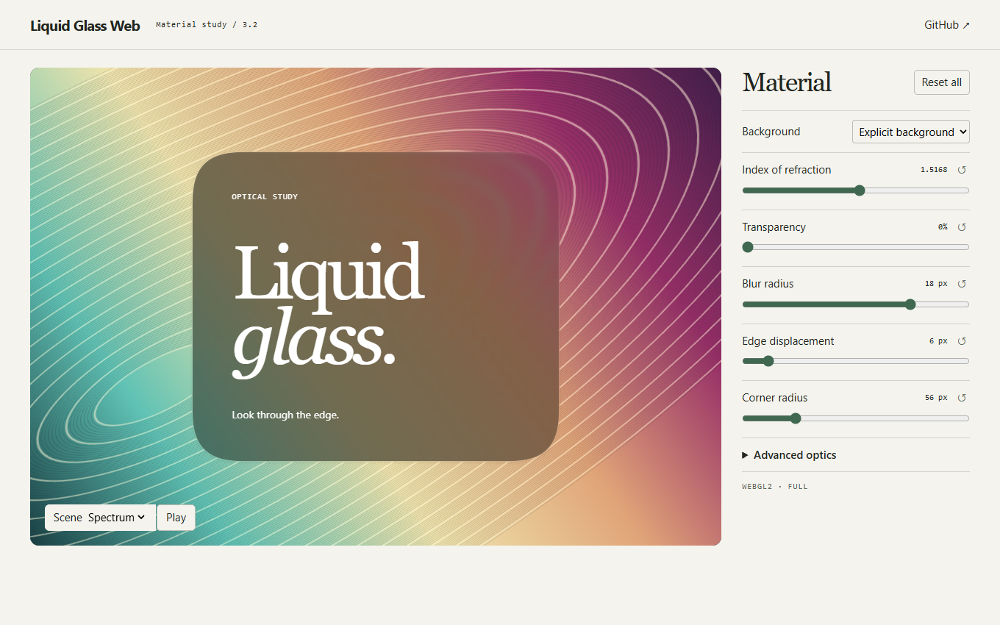

# Liquid Glass Web

[简体中文](README.zh-CN.md) · [Live material editor](https://um7lab.github.io/liquid-glass-web/demo/) · [Visual and GPU measurements](docs/validation.md)

Bring the neutral glass from **Liquid Glass Windows 3.2** to a web page. A line running behind a panel stays registered in the center and bends near the bevel. Light at the rim picks up nearby colors. A separate brightness control keeps white type legible on bright scenes. Text, buttons and inputs remain ordinary HTML.

[](https://um7lab.github.io/liquid-glass-web/demo/)

## Add glass to HTML

The repository includes browser-ready builds. For local development, install the package from GitHub.

```sh
npm install github:UM7lab/liquid-glass-web
```

```js
import { LiquidGlass } from 'liquid-glass-web'

const glass = new LiquidGlass({ targets: '.glass' }).start()
glass.update({ ior: 1.7, refraction: 9, transparency: 0.25 })
glass.reset('ior')
```

A transparent card or navigation bar can sample the page’s own backdrop. On supported Chromium engines the library generates a Snell displacement map and applies one SVG displacement. The lightweight tone curve operates per color channel. Other engines use CSS blur, dimming and an inset rim. The full environment lighting and hue-preserving brightness curve are available with an explicit background.

## Match the Windows material

Place a background image, video or canvas in the layout, followed by the panels in paint order. Supply their common source to one controller. Use a positioned, isolated scene and give the panels transparent backgrounds. The renderer inserts one pointer-transparent canvas beside the source.

```html
<section class="scene">
  
  <article class="glass"><h2>Now playing</h2><button>Pause</button></article>
</section>
<style>
  .scene { position: relative; isolation: isolate; min-height: 360px; display: grid; place-items: center; }
  #cover { position: absolute; inset: 0; width: 100%; height: 100%; object-fit: cover; }
  .glass { position: relative; padding: 3rem; color: white; background: transparent; }
</style>
```

```js
const glass = new LiquidGlass({
  targets: '.glass',
  source: document.querySelector('#cover'),
  quality: 'auto',
  material: { ior: 1.5168, transparency: 0, protection: true }
}).start()
```

The source should contain the **opaque SDR background actually visible beneath the panels**. Compose transparent artwork with its background first. Keep the visible panels within the source. The renderer supports axis-aligned layout, page and nested scrolling, device pixel ratios, and ordinary percentage or pixel object positioning. Rotated, skewed or perspective-transformed scenes and arbitrary intervening DOM layers require a precomposed source. Cross-origin images and video need the appropriate CORS response and a `crossorigin` attribute set before loading. A blocked upload automatically selects the page-backdrop mode.

| Background | When glass updates |
| --- | --- |
| Image | On load, material or geometry changes |
| Video | On a new video frame, seeking or geometry changes |
| Canvas | Call `glass.invalidate()` after drawing each changed frame |
| Drawable HTML | Use a direct `[drawable]` child of a visible `canvas[content="drawable"]` dedicated to a 2D context. Pass the child as `source`. The adapter draws it to fill the host on paint events. Use a regular HTML background on browsers without this capability. |

## Material controls

Lengths use CSS pixels. Strengths and transparency use fractions. Each setting can be updated live or reset on its own.

| Setting | Default | Meaning |
| --- | ---: | --- |
| `ior` / `refraction` | 1.5168 / 6 | Optical curve (1–2) and maximum edge shift (0–64 px). At IOR 1 the edge shift is zero. |
| `transparency` | 0 | Mix clear background into the full material before brightness protection. The foreground retains its own opacity. |
| `blurRadius` | 18 | Gaussian support radius, approximately three standard deviations (0–24 px). |
| `radius` / `bevel` | 56 / 16 | Visual corner radius and bevel width. Full mode uses exponent-3 continuous corners. |
| `highlight` / `innerContour` / `bodyLens` | .12 / .03 / 0 | Surface light, inner contour and optional body magnification. |
| `environmentStrength` / `environmentRadius` | .35 / 24 | Local color contribution and sampling reach. |
| `contour` / `shadow` | `'environment'` / true | Use `'white'` for neutral light. Shadow follows material opacity. |
| `protection` / `compression` | true / .5 | Compress bright linear luminance while preserving the narrow optical rim. At full transparency, disable protection or set compression to zero for a complete bypass. |

The exported `defaults` and `limits` provide values for control panels. Use `glass.settings` to serialize current values, `update(patch)` to apply settings, `reset()` for all defaults and `stop()` on unmount. Call `refresh()` after changing selector membership or moving panels through application-controlled transforms. Selector targets are also discovered on insertion and removal. To replace a source, stop the controller and start one with the new source.

## React and script tags

```tsx
import { useLiquidGlass } from 'liquid-glass-web/react'

function Card({ image }: { image: HTMLImageElement | null }) {
  const ref = useLiquidGlass<HTMLElement>({ source: image, material: { transparency: 0.2 } })
  return <article ref={ref}><h2>Album details</h2></article>
}
```

Hooks with equivalent source, quality and material share a renderer. React is an optional peer dependency.

```html
<script src="./dist/glass.global.js"></script>
<script>
  const glass = new LiquidGlassWeb.LiquidGlass({ targets: '.glass' }).start()
</script>
```

## Rendering budget

Static glass schedules work on demand. Visible panels share a source texture and blur result. The default quality controller reduces intermediate blur resolution under sustained load and can limit background updates to 30 Hz. It restores quality after a sustained lower cost. The final contour uses device pixels within an eight-megapixel output budget. Explicit modes are `full`, `balanced` and `economy`. Text stays at the browser’s native resolution in every mode.

`glass.status` exposes the actual backend, fallback reason, tier, frame limit, draw/upload/blur counts and asynchronous shader GPU time where available. Context restoration and media reloads reattempt the full path. Call `retry()` after fixing an unavailable source. Browser-composited SVG and CSS work is measured externally in the benchmark.

## Build and test

```sh
npm ci
npm run build
npm test
python -m http.server 8000
```

Open `http://localhost:8000/demo/`. The default README, demo and bindings ship in the Git repository. The test fixtures, native reference generation and Windows GPU measurement procedure are in the [validation report](docs/validation.md).

MIT licensed. The shader derives from the Windows 3.2 renderer. The predecessor Aurora Glass is retained as a pinned benchmark baseline. [License](LICENSE) · [Attribution](NOTICE)
