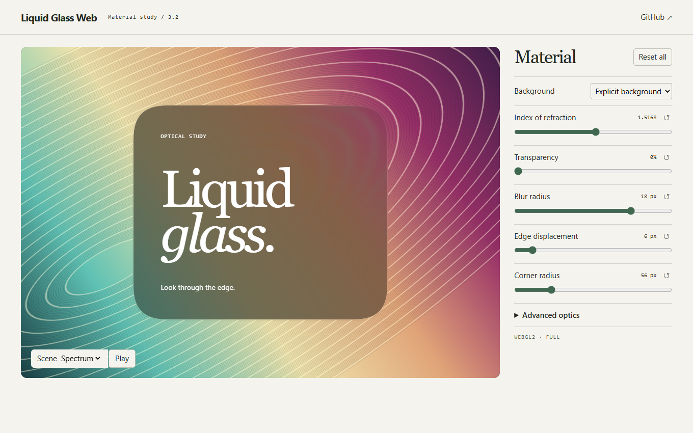

# Liquid Glass Web

[English](README.md) · [在线材质编辑器](https://um7lab.github.io/liquid-glass-web/demo/) · [画质与性能实测](docs/validation.md)

把 **Liquid Glass Windows 3.2** 的中性玻璃带到网页。让一条网格线穿过面板，中央保持对齐，到了边缘才弯折。把青色或粉色物体移到边缘附近，高光会映出它的颜色。文字和按钮始终由浏览器绘制。亮度保护可以单独调节，方便在浅色背景上阅读白字。

[](https://um7lab.github.io/liquid-glass-web/demo/)

## 给普通网页加玻璃

仓库附带浏览器可直接使用的构建产物，也可以从 GitHub 安装。

```sh
npm install github:UM7lab/liquid-glass-web
```

```js
import { LiquidGlass } from 'liquid-glass-web'

const glass = new LiquidGlass({ targets: '.glass' }).start()
glass.update({ ior: 1.7, refraction: 9, transparency: 0.25 })
glass.reset('ior')
```

给透明卡片或导航栏指定选择器即可。支持的 Chromium 浏览器会按 Snell 曲线生成位移图，做一次 SVG 边缘折射；轻量版按颜色通道近似压低亮部。其他浏览器使用 CSS 模糊、调光和细轮廓。要获得真实环境取色和保留色相的亮度保护，请指定背景。

## 接近本机 3.2 的效果

把图片、视频或 Canvas 放在面板后面，将这个元素作为 `source` 交给库。一个控制器可以管理多块玻璃，共享背景纹理和模糊结果。背景和面板放入同一个定位容器，面板底色设为透明。

```html
<section class="scene">
  
  <article class="glass"><h2>正在播放</h2><button>暂停</button></article>
</section>
<style>
  .scene { position: relative; isolation: isolate; min-height: 360px; display: grid; place-items: center; }
  #cover { position: absolute; inset: 0; width: 100%; height: 100%; object-fit: cover; }
  .glass { position: relative; padding: 3rem; color: white; background: transparent; }
</style>
```

```js
const glass = new LiquidGlass({
  targets: '.glass',
  source: document.querySelector('#cover'),
  quality: 'auto',
  material: { ior: 1.5168, transparency: 0, protection: true }
}).start()
```

背景应包含面板下方实际可见的、不透明的 SDR 画面。透明素材先与底色合成，并让玻璃落在背景覆盖范围内。支持横平竖直的布局、页面和容器滚动、不同像素密度，以及常见的百分比或像素图片定位。旋转、倾斜、透视布局或中间叠有其他内容的页面，需要先合成背景。跨域图片或视频须在载入前设置 `crossorigin`，并由资源服务器允许跨域读取。上传失败时会自动切换到网页背景模式。

| 背景来源 | 何时更新 |
| --- | --- |
| 图片 | 加载完成、参数或几何位置改变时 |
| 视频 | 新视频帧、跳转进度或几何位置改变时 |
| Canvas | 应用画完发生变化的一帧后调用 `glass.invalidate()` |
| 指定 HTML 层 | 给可见的 `canvas[content="drawable"]` 放一个带 `drawable` 属性的直接子元素，将子元素传给 `source`。适配器在绘制事件中用该内容填满 2D Canvas。不支持该能力的浏览器可继续走普通 HTML 接入。 |

## 参数

长度使用 CSS 像素，强度和透明度使用 0–1 的小数。各项均支持实时更新和单独复位。

| 参数 | 默认值 | 用途 |
| --- | ---: | --- |
| `ior` / `refraction` | 1.5168 / 6 | 折射率 1–2，最大边缘位移 0–64 px。折射率为 1 时边缘位移归零。 |
| `transparency` | 0 | 在亮度保护之前混合清晰背景与完整玻璃。文字保留自身透明度。 |
| `blurRadius` | 18 | 模糊半径 0–24 px，约为高斯核的三倍标准差。 |
| `radius` / `bevel` | 56 / 16 | 视觉圆角与曲面边缘宽度。高保真模式采用三次连续圆角。 |
| `highlight` / `innerContour` / `bodyLens` | .12 / .03 / 0 | 高光、内轮廓、主体放大比例。默认中央无放大。 |
| `environmentStrength` / `environmentRadius` | .35 / 24 | 周围颜色对边缘的影响及采样距离。 |
| `contour` / `shadow` | `'environment'` / true | 改成 `'white'` 可使用白色轮廓。阴影随材质透明度变化。 |
| `protection` / `compression` | true / .5 | 在线性光空间压缩亮部，保留窄边缘。透明度为 1 时关闭保护或将压缩设为 0，即可完全跳过材质绘制。 |

`defaults` 和 `limits` 可直接用于制作滑块。`glass.settings` 可保存为 JSON，`update(patch)` 实时更新，`reset()` 全部复位，卸载时调用 `stop()`。切换目标 CSS 类或通过应用自行变换面板位置时调用 `refresh()`。选择器会自动发现新增或移除的元素。切换背景元素时，先停止原控制器，再以新背景启动。

## React 和普通脚本

```tsx
import { useLiquidGlass } from 'liquid-glass-web/react'

function Card({ image }: { image: HTMLImageElement | null }) {
  const ref = useLiquidGlass<HTMLElement>({ source: image, material: { transparency: 0.2 } })
  return <article ref={ref}><h2>专辑信息</h2></article>
}
```

背景、画质和材质参数相同的 hook 共享渲染器。直接引入脚本也可以使用。

```html
<script src="./dist/glass.global.js"></script>
<script>
  const glass = new LiquidGlassWeb.LiquidGlass({ targets: '.glass' }).start()
</script>
```

## 性能与验证

静止时按需绘制。默认 `auto` 会在持续高负载时先降低模糊纹理分辨率，仍然吃紧时将动态玻璃限制到 30 Hz。负载持续下降后恢复画质。也可以手动选择 `full`、`balanced` 或 `economy`。最终轮廓遵循设备像素密度，输出画布上限为八百万像素；文字始终使用页面本身的分辨率。

`glass.status` 可查看实际渲染模式、回退原因、画质档、刷新上限、提交帧数、纹理上传次数、模糊次数及可用的着色器 GPU 耗时。WebGL 上下文恢复或媒体重新加载后会重试高保真路径，手动修复来源后也可调用 `retry()`。SVG 和 CSS 由浏览器合成，性能报告使用系统计数器实测。

```sh
npm ci
npm run build
npm test
python -m http.server 8000
```

打开 `http://localhost:8000/demo/`。原生参考图、浏览器对照与性能测试的复现方法见[验证报告](docs/validation.md)。项目采用 MIT 许可，3.2 材质来自原生 Windows 实现，旧 Aurora 作为基准保留。[许可证](LICENSE) · [来源说明](NOTICE)
