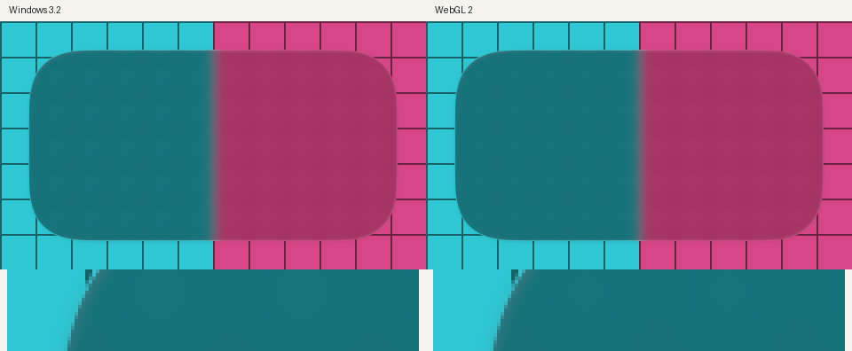

# Visual and GPU validation

Measurements from November 25, 2026. Chromium used hardware D3D11 through ANGLE on a Windows machine with an NVIDIA GeForce RTX 4090. The native reference ran the original Windows 3.2 shader through the D3D11 WARP test pipeline. All inputs are generated SDR images.

## Native comparison



The source, viewport crop, panel geometry and default material are identical. Each image is 480 × 280, with a 416 × 216 panel inset by 32 px at DPR 1. We compare the final composited RGB image, including the uncovered background, and also report the mean error in a separate left-edge strip. Values are absolute differences on an 8-bit channel scale of 0–255.

| Scene | Mean error | 99th percentile | Edge-strip mean |
| --- | ---: | ---: | ---: |
| [Grid](fixtures/grid-web.png) | 0.584 | 5 | 0.490 |
| [Cyan and pink](fixtures/colors-web.png) | 0.095 | 1 | 0.176 |
| [White](fixtures/white-web.png) | 0.004 | 0 | 0.046 |
| [Dark](fixtures/dark-web.png) | 0.002 | 0 | 0.026 |

The largest differences occur around high-frequency grid lines. WebGL uses a lower-resolution separable Gaussian and a browser texture-upload path. The test accepts a whole-image mean below 3 and a 99th percentile below 14 for each scene. Separate assertions check exact transparent bypass, center registration, zero edge displacement at IOR 1, and a changed edge when IOR increases. These image tolerances apply to full quality. The lightweight page-backdrop modes approximate the material. [Source and reference PNGs](fixtures/) · [Machine-readable comparison](fixtures/comparison.json)

## GPU workload

Chrome **158.0.8127.38**, ANGLE D3D11, driver **32.0.16.1656**, 1280 × 720 CSS px, DPR 1. The moving Canvas source updated at 60 Hz on a roughly 120 Hz browser animation clock. Each trial warmed up for 1.1 seconds and measured for 5 seconds. For the six-panel motion test we rotated the order of the four modes across four trials.

**GPU cost** is milliseconds of 3D-engine running time per elapsed second for the isolated Chrome GPU process, obtained from Windows GPU Engine counters. It includes browser compositing. It excludes other processes, including the desktop compositor, and cannot measure device power or display latency. Shader timer queries cover the glass draw and blur commands after source upload. The raw report also contains other-engine totals and individual trial results.

| Scenario | Bare page | Aurora Glass 0.1 | New page backdrop | New WebGL 2 |
| --- | ---: | ---: | ---: | ---: |
| 1 moving panel background | 15.87 | 50.73 | 43.05 | 39.29 |
| 6 panels scrolling over a static background | 15.96 | 100.36 | 100.29 | 35.92 |
| 6 stationary panels, static background | 0.06 | 0.32 | 0.46 | 0.12 |
| **6 panels, moving background** (median) | **21.47** | **84.30** | **81.98** | **45.58** |

In the six-panel motion run, WebGL 2 used **46% less** 3D-engine time than the predecessor. It stayed at full quality and submitted all 301 source frames in each trial. Its shader-time p95 ranged from 0.186 to 0.222 ms. The SVG median was about 3% lower than the predecessor, with a wide 37.76–113.77 ms/s range. A repeatable large saving for ordinary DOM backgrounds has yet to be established.

| Six-panel motion | Missed animation slots / total | Median trial p95 frame interval |
| --- | ---: | ---: |
| Bare page | 4 / 2400 | 8.70 ms |
| Aurora Glass | 5 / 2400 | 8.65 ms |
| New page backdrop | 5 / 2400 | 8.65 ms |
| New WebGL 2 | 2 / 2400 | 8.70 ms |

Missed slots are estimated from animation-frame timestamp gaps against the measured idle cadence. These small counts describe this run. In a separate 10-second static check, the library submitted **zero additional draws and zero texture uploads**. An isolated test of the predecessor’s optional full-screen animated gradient raised the bare idle page from 0.06 to 88.55 ms/s. With six old panels and that gradient, it reached 171.16 ms/s. The main A/B table holds the background workload equal across modes. [Raw trials](performance.json) · [Pinned Aurora source](https://github.com/UM7lab/aurora-glass/tree/01e806dcf1242b77b165039448da576ae0283185)

## Browser coverage

- Chrome and Edge 158 passed real image and Canvas input, paused-video upload suppression, offscreen/resume, drawable HTML paint, blocked cross-origin input, lost/restored WebGL context, unavailable WebGL, React Strict Mode sharing and unmount, and the standalone script entry.
- Chromium at emulated 390 × 844 / DPR 3 and 800 × 550 / DPR 2 rendered the WebGL path. These checks cover layout and device scale. Physical mobile hardware, battery use and Safari remain unmeasured.
- Performance here describes the desktop GPU and benchmark scene. The lightweight path’s per-channel tone curve and circular CSS clip can differ visibly from the full material on saturated backgrounds or at corners.

## Reproduce

Build the checkout with `npm ci && npm run build`. Run `npm test` for material contracts. The checked-in native PNGs let other platforms run image comparisons independently of the Windows source tree.

Install Python packages `playwright pillow numpy` and, for the Windows benchmark, `pywin32`. Build the React test fixture and run the browser checks from the repository root.

```sh
npx esbuild tests/react.jsx --bundle --outfile=.local/react-fixture.js
python tests/browser.py --chrome "<Chrome executable>"
python tests/sources.py --chrome "<Chrome or Edge executable>"
```

To regenerate native references on Windows with MSVC and the Liquid Glass Windows 3.2 checkout at revision `869229c`, use its original shader and blur implementation.

```sh
cmake -S tests/native -B .local/native -A x64 -DNATIVE_ROOT="<Windows 3.2 source directory>"
cmake --build .local/native --config Release
python tests/fixtures.py --native .local/native/Release/glass_reference.exe
```

For performance, build Aurora Glass commit `01e806d` separately with its own `npm ci && npm run build`. The test server serves only the legacy JS bundle and stylesheet from that checkout. Use the same Chrome executable for all four modes.

```sh
python tests/performance.py --chrome "<Chrome executable>" --baseline "<built Aurora checkout>" --duration 5000 --repeat 4
```
